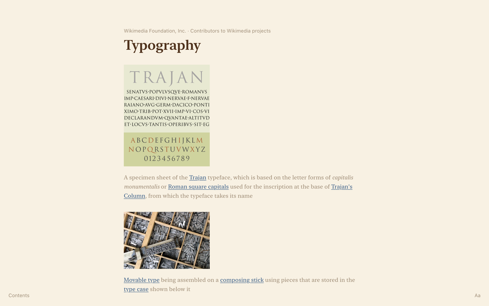
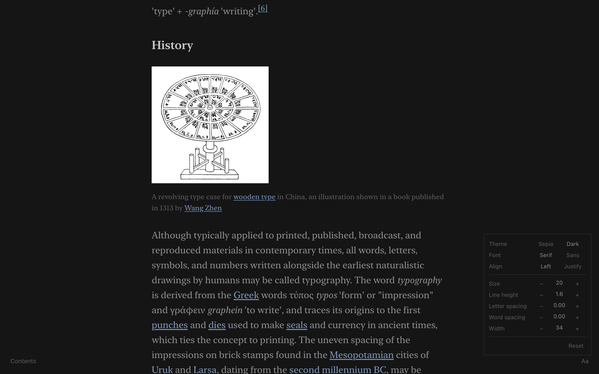
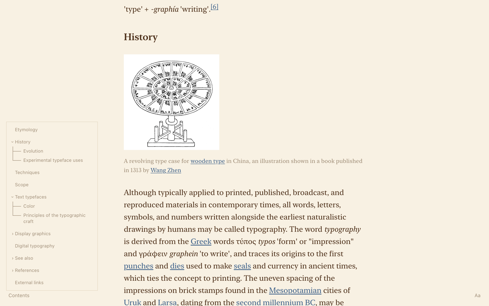
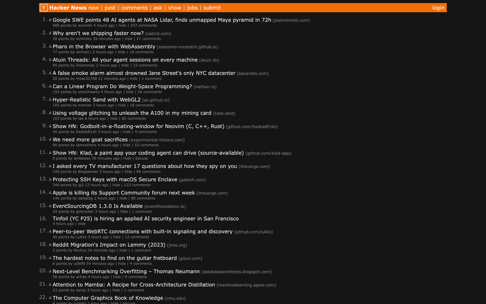

<h1 align="center">Reader+ (browser extension)</h1>

  simple clean minimal article reader.

  <a href="https://github.com/shvm-mane/reader-plus/releases/latest"><b>DOWNLOAD</b></a>

## what it does

- **reader view:** click the icon to turn any article into a clean page, click again or `esc` to close
- **settings:** hover `Aa` (bottom right) for sepia/dark, serif/sans, justify, size, line height, spacing, width
- **contents:** hover `Contents` (bottom left) for a tree of the article's headings, click to jump
- **page dark mode:** `⌥⇧D` darkens the actual website, remembered per site, colours and images kept intact

## install

**chromium**
1. download `reader-plus-chromium.zip` from [releases](https://github.com/shvm-mane/reader-plus/releases/latest) and unzip it
2. go to `chrome://extensions`, turn on **developer mode**
3. **load unpacked** → pick the unzipped folder
4. (optional) if `⌥⇧D` does nothing, set it in `chrome://extensions/shortcuts`

## credits

- **[readability](https://github.com/mozilla/readability)** by mozilla (apache 2.0): the article extraction (same engine as firefox reader view)

## license

[MIT](LICENSE) (includes readability's apache 2.0 notice)
